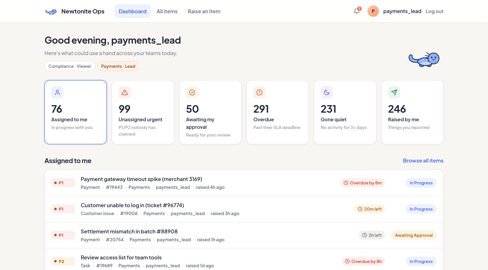
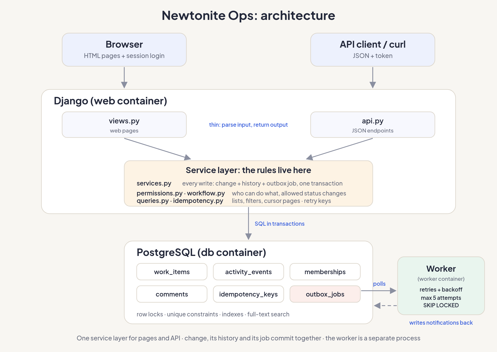

# Newtonite Ops

An internal tool for operations teams to raise, claim, track and resolve work items such as incidents, payment problems, customer issues and compliance tasks.

Anyone can raise an item for any team. Members of that team pull work from their queue and a second person (a Lead) approves the result. Every change is recorded in an append-only history. It's built to behave correctly under pressure: when **two people click at once**, when someone **edits a stale page**, when a **request is retried**, and when someone tries something they **aren't allowed to do**.

Built with **Django 5.2, Django REST Framework, PostgreSQL 16** and plain HTML/CSS templates. There's a JSON API and a web UI, and both use the same service layer.

**Live demo:** https://newtonite-ops-v2ie.onrender.com (log in with any [demo account](#demo-accounts); the first visit can take up to a minute while the free server wakes up)



---

## Contents

- [Quick start](#quick-start)
- [Demo accounts](#demo-accounts)
- [Running the tests](#running-the-tests)
- [What it does](#what-it-does)
- [Architecture](#architecture)
- [API](#api)
- [Project layout](#project-layout)
- [Deploying](#deploying)
- [Known limitations](#known-limitations)
- [Next week I would…](#next-week-i-would)

---

## Quick start

**Prerequisites:** Docker with Docker Compose v2. Nothing else is needed on your machine.

```bash
git clone https://github.com/khushisaraswat03/newtonite-ops-2300970130069.git
cd newtonite-ops-2300970130069

cp .env.example .env
docker compose up --build
```

The first start takes **about 30 seconds**: it creates the database tables and fills them with demo data. When the log shows `Starting development server`, open **http://localhost:8000** and log in with any account below.

`docker compose up` creates three containers:

| Container | What it runs |
|---|---|
| `db` | PostgreSQL 16 (published on host port **5433**, to avoid clashing with a local Postgres) |
| `web` | Django on port **8000**. On start it runs migrations, and seeds demo data if the database is empty |
| `worker` | The outbox worker that delivers notifications in the background |

The demo data is **4 teams, 11 users and 3,000 items** with consistent history. Restarting never wipes it. To reset it to a clean state at any time (with the containers running):

```bash
docker compose exec web python manage.py seed
```

Use `--items` to try pagination at a larger scale:

```bash
docker compose exec web python manage.py seed --items 50000
```

To stop everything: `docker compose down` (add `-v` to also delete the database volume).

---

## Demo accounts

All accounts use the password **`demo1234`**. In development the login page also has one-click buttons for each account.

| Username | Role(s) | Good for demonstrating |
|---|---|---|
| `payments_member` | Payments: Member | Claiming work, submitting for approval |
| `payments_member2` | Payments: Member | The second person in a claim race or stale edit |
| `payments_lead` | Payments: **Lead**, Compliance: **Viewer** | Approving, rejecting, handoff; roles are per team |
| `compliance_lead` | Compliance: Lead | Receiving a handed-off item |
| `compliance_member` | Compliance: Member | Being an outsider to Payments items (gets 404) |
| `support_lead` | Customer Support: Lead | |
| `support_member` | Customer Support: Member | Raising items for another team and following them |
| `platform_lead` | Platform: Lead | |
| `platform_member` | Platform: Member | |
| `auditor` | **Viewer** in every team | Read-only access everywhere |
| `admin` | **Global Admin** | Can act in every team; also has Django admin at `/admin/` |

---

## Running the tests

With the containers running, in a second terminal:

```bash
docker compose exec web pytest
```

**84 tests**, about 15 seconds. They run against a real PostgreSQL test database, because the concurrency tests rely on Postgres row locking.

To run them from a local virtualenv instead (Python 3.10+):

```bash
python3 -m venv .venv
.venv/bin/pip install -r requirements.txt
POSTGRES_HOST=localhost POSTGRES_PORT=5433 .venv/bin/pytest
```

What the tests cover, by file:

| File | Covers |
|---|---|
| `test_claim.py` | **Concurrent claim**: three threads claim at the same instant, exactly one wins. Release, unassign |
| `test_edit.py` | **Stale update rejected** and data unchanged. Only Leads change priority; due-date rules |
| `test_workflow.py` | **Invalid transitions** and **non-Lead / self approval** rejected. Reopen rules, cancel is final |
| `test_handoff.py` | Handoff resets the item for the new team; old team loses access |
| `test_history.py` | **A failure while writing history leaves no item behind**; every change has its event |
| `test_idempotency.py` | **Same key twice creates one item**. 5 simultaneous duplicates create one item |
| `test_api_actions.py` | **User outside the team gets 404 on every read and write**. Viewers get 403 |
| `test_api_list.py` | Visibility, filters, search, urgency ordering, cursor pagination |
| `test_outbox.py` | Job written with the change, **processed twice gives one notification**, **retry with backoff then failed** |
| `test_pages.py` | Web UI: conflict screen, double-submitted forms, authorization on pages |

---

## What it does

### Work items

Each item has a title, description, **type** (incident, customer issue, payment, compliance, task), **priority** (P1–P4), **status**, owning **team**, **assignee**, creator, optional due date, an SLA deadline and a **version number**.

### Roles

Roles are **per team**. One person can be a Lead in Payments and a Viewer in Compliance.

| | Viewer | Member | Lead | Admin |
|---|:-:|:-:|:-:|:-:|
| See the team's items | ✅ | ✅ | ✅ | ✅ all teams |
| Raise items (for any team) | | ✅ | ✅ | ✅ |
| Claim, comment, submit for approval | | ✅ | ✅ | ✅ |
| Adjust the due date of an item they're working on | | ✅ | ✅ | ✅ |
| Approve, send back, close, cancel | | | ✅ | ✅ |
| Reopen a resolved or closed item | | ✅ \* | ✅ | ✅ |
| Change priority | | | ✅ | ✅ |
| Unassign a stuck item, hand off to another team | | | ✅ | ✅ |

\* A Member can reopen an item only if they were the one working on it (it comes back to them) or the one who raised it (it goes back to the queue).

If you raise an item for another team, you can still see it and comment on it, but you can't work on it. You can also reopen it if the fix didn't work. A user who can't see an item gets **404**, so they can't tell it exists. A user who can see it but isn't allowed to perform an action gets **403**.

### Workflow

```
Open ─claim─▶ In Progress ──▶ Awaiting Approval ──approve──▶ Resolved ──▶ Closed
                   ▲                  │                          │           │
                   └──── send back ───┘                          │           │
                   └──── reopen by previous assignee (keeps it) ─┴───────────┤
 Open ◀──────────────── reopen by Lead or creator (back to queue) ───────────┘

Open / In Progress / Awaiting Approval ──cancel──▶ Cancelled (final)
```

- **Pull model:** items start unassigned in the team queue and people claim them. Leads never assign work to a specific person. They can only unassign a stuck item (with a reason) so someone else can claim it.
- **Four-eyes approval:** only a Lead can approve, and **never their own work**.
- **Reasons are required** for sending back, cancelling, reopening, unassigning, handing off, lowering priority and pushing a due date later. They're stored in the history.
- **Handoff** moves an item to another team in one step: it becomes Open and unassigned, keeps its priority, and its SLA restarts for the new team.

### SLA and attention views

SLA deadlines are P1 **4 hours**, P2 **24 hours**, P3 **3 days**, P4 **5 days**. They're measured from when the current team received the item, and the clock stops at Resolved. The dashboard has live counts for **Assigned to me**, **Unassigned urgent** (P1/P2), **Awaiting my approval**, **Overdue** (past the SLA deadline), **Gone quiet** (no activity for 3+ days) and **Raised by me**.

### Correctness under pressure

| Situation | What happens |
|---|---|
| Two people claim the same item | One conditional `UPDATE … WHERE assignee IS NULL`. One wins, the other gets **409** showing who has it |
| Editing a page someone else changed | Every write sends the `version` it saw. If it's stale: **409** with the latest item; the UI shows what changed and keeps your input |
| Double-click or network retry | `Idempotency-Key` (API header or hidden form field) returns the stored result instead of acting twice. Buttons also disable on click |
| Invalid jump or wrong person | Rejected on the server by a single transitions table (**400** / **403**) |
| Notification delivery fails | Outbox job retries with backoff (10s, 20s, 40s…) and is marked failed after 5 attempts |

Every change and its history event (and any notification job) are written **in the same database transaction**, so the history can't disagree with the item.

---

## Architecture



- The browser uses server-rendered pages. API clients use JSON with token auth. Both go through thin views into the **same service layer**, so the rules can't drift apart.
- `services.py` performs every write **in one transaction**: the change, its activity event and any outbox job. `permissions.py` and `workflow.py` decide what's allowed; `queries.py` builds filtered, paginated lists.
- **PostgreSQL** is the only store: row locks for concurrency, unique constraints for idempotency, a GIN index for full-text search, and the outbox table as the job queue.
- The **worker** is a separate process. It polls the outbox with `SELECT … FOR UPDATE SKIP LOCKED`, delivers notifications, and retries failures.

---

## API

Authenticate with `POST /api/auth/token/` (`username`, `password`) and send `Authorization: Token <token>` on every request.

| Method & path | Purpose |
|---|---|
| `GET /api/me/` | Current user and roles per team |
| `GET /api/items/` | List: `view`, `status`, `priority`, `type`, `team`, `assignee` (`me`/`none`/id), `q`, `cursor`, `page_size` (max 100) |
| `POST /api/items/` | Raise an item: `team`, `title`, `type`, `priority`, optional `description`, `due_date` |
| `GET /api/items/<id>/` | Detail, including `allowed`: the actions the caller may take right now |
| `PATCH /api/items/<id>/` | Edit priority / due date: `version` required, `reason` when needed |
| `POST /api/items/<id>/claim/` · `release/` | Claim / release |
| `POST /api/items/<id>/unassign/` | Lead frees a stuck item: `reason` |
| `POST /api/items/<id>/transition/` | `version`, `status`, `reason` when needed |
| `POST /api/items/<id>/handoff/` | `version`, `team`, `reason` |
| `GET` / `POST /api/items/<id>/comments/` | List (paginated with `before`) / add (`body`) |
| `GET /api/items/<id>/activity/` | History, newest first, paginated with `before` |

`view` can be `assigned_to_me`, `unassigned_urgent`, `awaiting_my_approval`, `sla_breached` (the Overdue tile), `stale` (Gone quiet) or `raised_by_me`. Lists are sorted most urgent first (priority, then SLA deadline) and paginated with an opaque `next_cursor`.

All writes accept an optional `Idempotency-Key` header. Errors always look like `{"detail": "..."}` (plus `errors` for invalid fields): **400** invalid input or transition, **403** not allowed, **404** not found or not visible, **409** conflict (with `current`, the latest item), **422** idempotency key reused for a different request.

---

## Project layout

```
config/                 Django settings and root URLs
ops/
  models.py             Team, Membership, WorkItem, ActivityEvent, Comment, IdempotencyKey, OutboxJob, Notification
  permissions.py        Who can see and do what (one place)
  workflow.py           Allowed status changes, who may make them, when a reason is needed
  services.py           Every write: change + history + outbox job in one transaction
  queries.py            Filters, dashboard views, search, cursor pagination
  idempotency.py        Idempotency keys for the API and web forms
  outbox.py             Outbox jobs, handlers, retry with backoff
  api.py, api_urls.py   JSON API
  views.py, urls.py     Web pages
  templates/, static/   HTML templates and the CSS
  management/commands/  seed, run_worker
scripts/
  start-production.sh   Production start: migrate, seed if empty, worker + gunicorn
render.yaml             Render blueprint (web service + PostgreSQL)
  tests/                pytest suite
```

---

## Deploying

The repo includes a `render.yaml` blueprint for **[Render](https://render.com)** (free plan, no credit card needed):

1. Push the repo to GitHub.
2. On Render, choose **New → Blueprint** and pick the repo. It creates a **web service** and a **PostgreSQL database**.
3. Wait for the first build (about 5 minutes). On start the app runs migrations, seeds the demo data if the database is empty, and starts gunicorn.

Production runs with `DEBUG=0`, a generated secret key, static files served by WhiteNoise, and the database from `DATABASE_URL`. To stay on the free plan, the outbox worker runs **inside the web container** (see `scripts/start-production.sh`) instead of as a separate service. The demo-account buttons stay on the login page via `SHOW_DEMO_ACCOUNTS=1`.

Free Render services **sleep after 15 minutes without traffic**, so the first visit after a while can take up to a minute.

---

## Known limitations

- **No live updates.** Pages don't refresh themselves. You see other people's changes when you reload, and stale edits are caught by the version check.
- **Notifications are in-app only.** No email or Slack. The outbox and handler structure is ready for an external channel.
- **Simple auth.** Session login for the UI and non-expiring DRF tokens for the API. No SSO, password reset or token rotation.
- **Idempotency keys are never cleaned up.** In production they'd expire after about 24 hours via a scheduled job.
- **History is append-only at the application level.** The model refuses updates and deletes, but a database trigger or restricted DB role would be needed to stop raw SQL.
- **SLA ignores business hours and holidays**, and the stale threshold (3 days) is fixed.
- **Two SLA behaviours are deliberate but worth knowing.** A reopened item keeps its original deadline, so it can show as overdue straight away. Time spent waiting for a Lead's approval also counts toward the SLA.
- **Title and description can't be edited** after raising (a deliberate choice; see ENGINEERING_DECISIONS.md), and a due date can be changed but not cleared.
- **Pagination goes forward only** ("Next page" and "Back to start"), which is the trade-off of cursor pagination.
- **Dashboard counts are live `COUNT` queries.** Fine at this size, but they'd need caching or counters at much larger scale.
- **Local setup uses Django's development server.** `docker compose up` runs `runserver` with `DEBUG=1` for convenience. The deployed version uses gunicorn with `DEBUG=0` (see [Deploying](#deploying)).
- **On the free deployment the worker shares the web container.** That's fine for a demo, but in production it should be its own service so it can be scaled and restarted separately.

---

## Next week I would…

- **Send notifications by email or Slack.** Right now they only show up inside the app. Since they already go through the outbox, this is mostly one more handler. I'd also add a morning summary of overdue items for Leads so they don't get pinged for every single one.
- **Show live updates on open pages.** At the moment you only find out someone changed an item when you try to save. Server-sent events could warn you while you're still looking at it.
- **Make SLAs smarter.** Count only each team's working hours instead of 24/7, and pause the clock while the team is waiting on the customer.
- **Add a reports page.** Things like how long items wait before someone claims them, how long they take to resolve, and how often "fixed" items get reopened. All of this can be worked out from the history that's already recorded.
- **Clean up old data.** Idempotency keys only matter for a few minutes and notifications pile up, so a nightly job could delete old ones.
- **Protect the history in the database itself.** The app refuses to edit history, but someone with direct database access still could. A Postgres trigger or a separate database user that can only insert would stop that.
- **Add browser tests with Playwright.** My tests check the logic and the pages, but nothing actually clicks through the UI the way a real person would.
